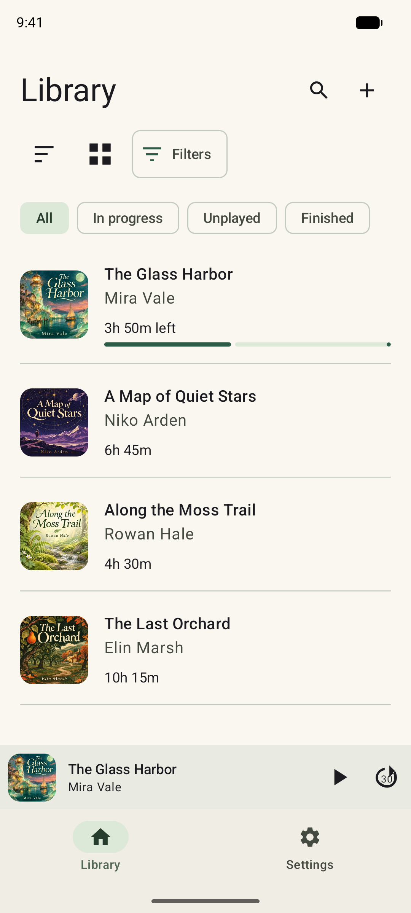
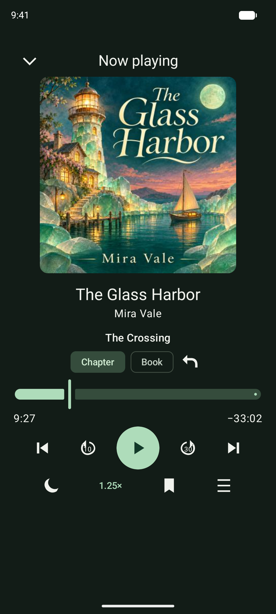
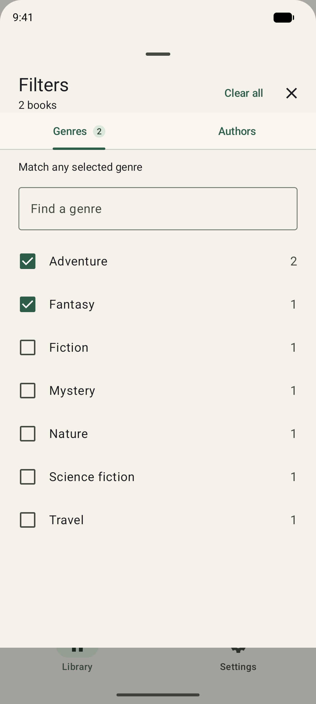

# PAudioBooks

An offline audiobook player for Android 8.0 and newer. Listen to your own local
books without an account, internet connection, or Google Play services.

[Releases](https://github.com/jnesew/PAudioBooks/releases) ·
[Usage guide](docs/USAGE.md) · [Build from source](docs/BUILDING.md)

PAudioBooks is in development. Obtainium needs a published, signed APK release;
the badge adds this repository as its source. Obtainium handles downloads and
updates separately from the offline player.

- Organize books in a list or cover grid, with search and genre/author filters.
- Listen in the background with chapters, speed controls, and remembered progress.
- Add bookmarks and notes, set a sleep timer, and choose a light or dark theme.
- Edit local book details and covers, and manually export progress and bookmarks.

| Library | Player | Filters |
| --- | --- | --- |
|  |  |  |

Screenshots show the real app at Pixel 8a resolution with a
[fictional demo library](docs/demo/README.md).

Choose audio files or a folder through Android's file picker, review the books,
and add them to your library. Audio plays from the chosen location, so keep those
files available. Removing a book leaves the original audio untouched.

Books, artwork, and listening records stay on your device. There are no ads,
analytics, streaming, or remote metadata lookups. Progress exports are unencrypted
and can contain personal notes; keep them somewhere private.

[MIT license](LICENSE) · [Forking guide](docs/FORKING.md) ·
[Developer documentation](docs/README.md)
