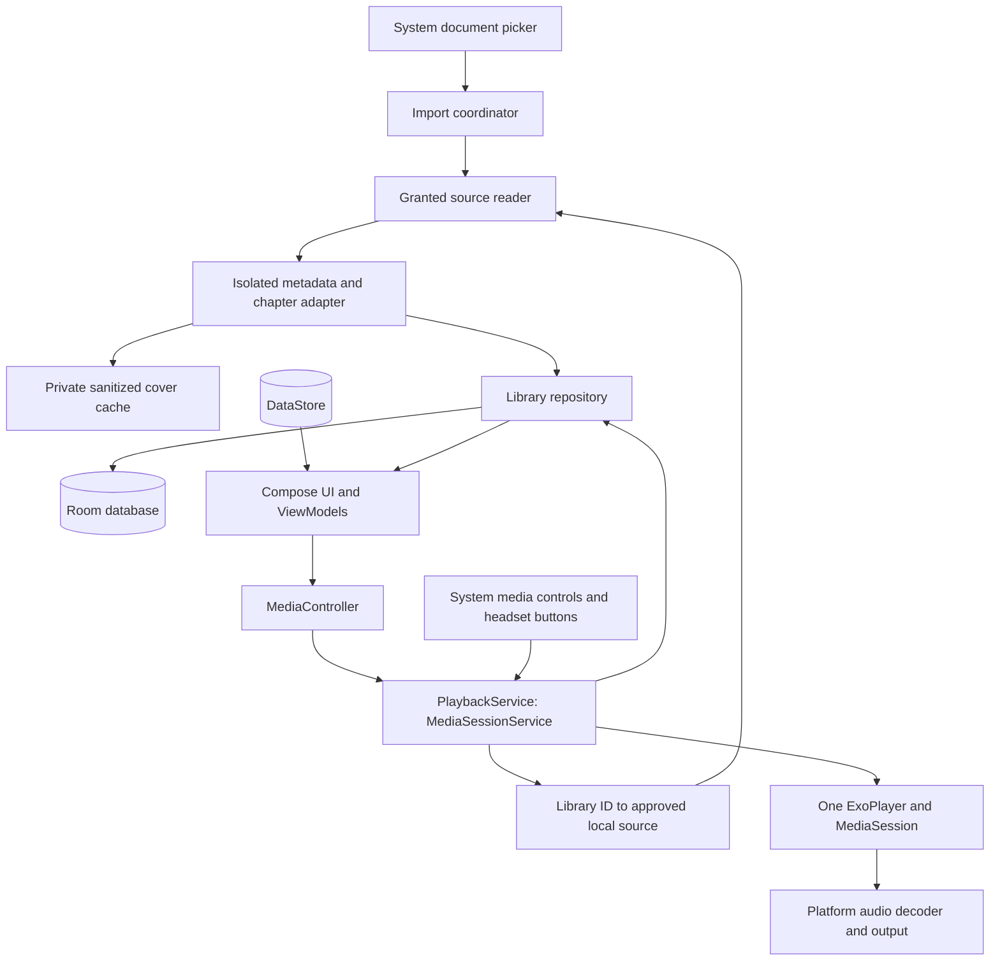

# Architecture

This document describes the selected stack and responsibility boundaries. Device,
provider, and release acceptance require independent evidence. See
[security](SECURITY_AND_PERMISSIONS.md) for the permission budget and
[product design](DESIGN_PLAN.md) for expected behavior.

## Technology decisions

| Concern | Choice | Reason and maintenance boundary |
| --- | --- | --- |
| Language | Kotlin, standard library, coroutines/Flow | Native Android tooling; structured asynchronous work |
| UI | Compose, Material 3, Activity, Lifecycle/ViewModel, Navigation | Official Jetpack components; accessibility and adaptive layouts |
| Playback | Media3 ExoPlayer + Session | Maintained Android stack for local media, transport, speed, and system integration |
| Inspection | Media3 Inspector/extractors; platform metadata API where sufficient | Reuse upstream container/tag/chapter parsing |
| Audio decode | Platform MediaCodec/AudioTrack through Media3 | Use device-maintained codecs; no bundled native decoder pack |
| Library | Room over Android SQLite | Transactional persistence, schema validation, migrations |
| Preferences | Preferences DataStore | Small persistent settings separate from relational library data |
| Files | SAF, ContentResolver, DocumentsContract | User-scoped source access without broad storage permission |
| Artwork | Android graphics APIs and a bounded local cache | No remote-image loader dependency required |
| Dependency injection | Explicit constructors and a small application container | Adequate for the initial single-module app |

Framework APIs are preferred when suitable. Jetpack is the deliberate next choice,
not an OS-provided dependency: its fixes ship only when this application is rebuilt
and updated. Do not depend on Google Play services, Firebase, vendor SDKs, hidden
APIs, or privileged AOSP components. Reuse public APIs, not copied framework code.

Media3 artifacts are pinned together to **1.11.1**; see
[the media runtime decision](decisions/0003-media-runtime.md). The app pins
compile/target SDK 37 with minSdk 26. [Building](BUILDING.md) documents the toolchain;
[the foundation decision](decisions/0001-foundation.md) records dependency review.
Inspector uses a supplied source factory retaining MP4 sample tables for QuickTime
chapters. Keep resource limits, cancellation, and parser isolation around upstream
extraction; source configuration alone cannot establish container compatibility.

Begin with `:app`. Packages: `ui/`, `library/`, `importing/`, `metadata/`,
`playback/`, `storage/`, `preferences/`, and `portability/`. Keep pure timeline,
ordering, and chapter validation logic free of Android UI dependencies. Split
Gradle modules only when build or ownership needs justify it.

Store the appearance choice as `SYSTEM`, `LIGHT`, or `DARK` in DataStore, defaulting
to `SYSTEM`. Resolve it against the system theme at the Compose root and supply
semantic Material color schemes. Theme changes recompose UI; they must not recreate
the playback service/player or reset navigation. Cover bitmaps remain unmodified.

## Responsibility boundaries

`RootApp` owns destination selection, picker entry points and controller wiring.
Library, book details and settings each have a separate screen file. Shared cover
rendering, display metadata and book-removal orchestration have explicit homes.
Library search/filter/sort is pure logic in `LibraryOrdering`, shared by list/grid.
`PlaybackPolicy` contains the pure controller, shutdown, save-failure and timer
rules; `PlaybackService` retains the sole player/session and platform callbacks.

`LibraryViewModel` retains import work, cancellation and staged-journal ownership.
Its `ProgressTransfer` collaborator owns transfer preview/export/apply and journal
recovery in the same ViewModel coroutine scope; it reports errors through a
callback and does not own a player or retain an Activity. About/privacy content,
license navigation and bounded license-asset loading are separate concerns.

Follow Android's [state-holder guidance](https://developer.android.com/topic/architecture/ui-layer/stateholders):
preserve work/state lifetime across Activity recreation and pass narrow actions
to collaborators. The [file-access guidance](https://developer.android.com/training/data-storage/shared/documents-files)
scopes picker access to chosen files and folders.

## Library genre and author facets

The selected [compact live filters](design/PROTOTYPE_TARGETS.md#library-and-covers)
use imported genre text and visible author credits already in `BookSummary`.
Choices and counts derive from the current local library, so import/metadata
completion creates choices without a genre registry, migration or extra I/O.
Normalize whitespace, canonical Unicode and case for identity, keeping a displayed
spelling. Split comma-delimited genres into up to 64 distinct tags per book;
periods and ampersands remain literal. Author text
uses conservative comma splitting: split when every comma-delimited part contains
multiple words, preserving initials/periods; otherwise retain the complete credit.
This handles common full-name lists while keeping Doe, Jane and ambiguous short
credits grouped. It cannot resolve every cultural/name convention from flattened
text. Keep raw metadata unchanged and bound derived authors to 32 per book.
Count each book once per tag and once in union results. The raw imported field
stays unchanged, so existing metadata gains
separate genre choices without a migration or source reread. Missing
fields have distinct sentinel keys, separate from any literal imported label.

Genre selections form a union, as do author selections; intersect those groups
with existing search/status criteria, then preserve the chosen sort for list/grid.
Facet counts respect the other facet plus search/status, without hiding zero-count
selected choices. Retain removed selected labels as zero-count choices so a stale
filter is always removable. Search within the sheet narrows options only.

DataStore persists both selection sets with the existing library preferences.
Atomic toggles avoid lost rapid selections; errors leave the stored selection
unchanged and show recovery text. The button's active state and selected-value
count carry library filter state without a visible tag/Clear row. Fixed tabs
keep Authors accessible above a long lazy genre list. The sheet applies live;
all dismissal methods keep selections, and Clear all resets both sets. Compact
windows keep tabs/Close fixed while the title/search can scroll with options.
Filtering does not send media commands, change Continue listening or replace the
loaded book. No parser, schema, provider, permission or runtime dependency changes.

Official [Compose bottom-sheet guidance](https://developer.android.com/develop/ui/compose/components/bottom-sheets)
and [sheet-state guidance](https://developer.android.com/develop/ui/compose/components/bottom-sheets-partial)
describe the native sheet lifecycle. Use ModalBottomSheet, remove it from
composition on dismissal, and skip partial expansion to keep controls reachable.
Verify the native result separately.

## Runtime boundaries

UI and service are in one app process initially. The service owns the sole player,
session, sleep timer, and serialized playback state. Activity recreation must not
interrupt sound. Inspection does not create an audible player or contend with
playback for an unbounded number of workers.

Use `MediaSessionService` for v1: the library is browsed inside the app, not exposed
as an external catalog. MediaLibraryService and the system resumption carousel
are a separate future decision. Save/restore in-app progress independently of
either service choice. Background service integration follows the
[official Media3 guidance](https://developer.android.com/media/media3/session/background-playback).

## Data model

Persist stable UUID identities and explicit ordering. Suggested entities:

| Entity | Important fields |
| --- | --- |
| Book | ID, imported metadata, separate user overrides, added/last-played timestamps, user-visible status |
| AudioAsset | ID, app-generated relative owned path, byte size, SHA-256, detected container/codec, nullable duration, availability |
| BookTrack | ID, book ID, asset ID, order, track title, nullable embedded book fields and role provenance; unique order within book |
| Chapter | ID, book-track ID, start/end media milliseconds, optional title, order, origin |
| ReadingState | Book ID, book-track ID, offset ms, speed, finished flag, update sequence/time |
| Bookmark | ID, book ID, book-track ID, offset ms, note, created time |
| ImportJob | ID, state, selected grouping, staged/committed asset IDs, byte progress, recoverable error |
| RecentSeek | Book ID, prior track/offset, new track/offset, time; bounded to 20 entries per book |

Store thumbnails as files and references, not bitmap blobs in Room. Keep imported
and user-edited fields separate. File names, titles, chapter numbers, and list
indices are never primary keys. Audio paths are generated internally and never
accepted from an export file or external controller.

Use 64-bit milliseconds for stored media positions, bytes for storage, and explicit
nullable/unknown durations. Convert Media3 units/sentinels at the adapter boundary;
never add `TIME_UNSET` to a timeline. A book's aggregate offsets are derived from
ordered tracks only when their required durations are known. Until then, show
track/chapter position and avoid a misleading full-book scrubber.

Check referential integrity, nonnegative offsets, valid chapter ranges, and unique
track ordering. Export Room schemas and never fall back to destructive migration.
Historical schema/transfer compatibility tests are outside this personal pre-release
scope; keep existing migrations to preserve the installed library. Metadata refreshes
update tags/chapters without replacing book/track identities, progress, bookmarks,
or overrides.

## Contributors and UI state

Schema 4 adds nullable imported/override translator and series number, and asset
MIME, through an additive 3→4 migration. Explicit role tags are read through pinned
Media3 entry classes; author/artist/album never imply narrator or translator.
Unedited imported fields stay imported; an empty optional override intentionally
hides that credit until Reset edits. Manual transfer writes version 2 and accepts
versions 1 and 2; version 1 cannot overwrite the new contributor overrides.

Overview chapters/bookmarks open on demand. Private same-UID validated track seeks
and serialized completion/reset commands preserve pause state and cached progress.
The public controller command allowlist remains restricted. Native icons retain
contextual names, 48dp targets, tooltips and state.

## Embedded audiobook metadata

Schema 6 adds nullable per-track `BookMetadata`, book-level imported genre,
publisher, date, release date and description, and a metadata-management flag.
Room generates the additive 5→6 migration; prior migrations remain. Existing
book values, overrides, identity, notes and progress survive. The
read-only Book information view shows:
description, genre, publisher and valid explicit release date. Generic tagged
DATE is hidden. No new editor, search rule or portability field is introduced.
Bounded description markup is converted to plain text
inside the isolated process using the public Android Html API without an image
loader. Only the flattened string crosses IPC; no HTML/spans reach Room or UI.

The collector reads Media3 entries rather than passing contributors through its
singular music-oriented builder. Author precedence is explicit AUTHOR, an
explicit involved-person role, ARTIST, then ALBUMARTIST. Narrator precedence is
NARRATOR, an explicit involved-person role, Vorbis PERFORMER, then COMPOSER.
Translator accepts its explicit tag or involved-person role. Series/number tags
precede movement fallbacks; a movement number is not attached to an unrelated
explicit series. Fallback origin is stored per track. Generic writer, conductor,
album or unrelated private-domain tags never become inferred people roles.

This uses [Xiph's audiobook role recommendations](https://xiph.org/vorbis/doc/v-comment.html),
[ID3 frame semantics](https://id3.org/id3v2.4.0-frames) and explicitly conventional
[Audiobookshelf mappings](https://audiobookshelf.org/docs/documentation/libraries/book-library/directory-structure/#file-metadata).
`IPLS`/`IPL` and unofficial ID3 movement entries arrive as Media3 BinaryFrame
payloads: only those allowlisted text payloads are decoded, with encoding/size
bounds. Containers, chapter tables and artwork still use the selected upstream
stack; this adds no container parser or runtime dependency.

Repeated people and genres are trimmed, deduplicated and sorted before joining
for the existing string fields. Storage does not split names on punctuation; the
library derives conservative author filter choices separately, as described above. Limits are
32 values and 4,096 characters per field, 4,096 inspected entries and 512Ki
characters of retained per-file book fields per book. Excess optional values are
omitted; exceeding the book budget aborts publication. Scalar disagreement within
a file stays unknown. Per-file priority is independent of entry order within
these limits. Book fields use exact agreement among nonempty per-file values;
missing first-file fields do not mask later values, and conflicts stay unknown.
Album/book title is separate from track title. A consistent album is used before
a consistent track title and the selection fallback; reviewed titles always win.
ALBUM identifies the source collection; TIT2/TITLE identifies the
track/work and can contain chapter-level names even for a one-file selection.
There is no universal guarantee for mistagged files: review edits remain decisive.

Persist per-file discoveries before recomputing book metadata in the same Room
transaction. This allows separate deferred passes and reviewed additions to
detect conflicts without losing earlier discoveries. Books created under this
policy recompute imported fields, including clearing a now-conflicting value.
Migrated books lack that provenance and retain existing imported values while
filling missing ones; no automatic reinspection or rewrite of their titles occurs.
All user overrides and listening history remain separate.

Catalog mappings include ID3 TPUB/TCON/TDRC/TYER/TDRL and custom description;
Vorbis publisher/organization, genre, date, release-date and description/comment;
Apple freeform equivalents and text `mdta` entries exposed by Media3. A generic
date retains its tagged precision and meaning; it is not labeled a publication
date. Explicit release dates are stored separately. Metadata not exposed by the
pinned extractor remains unknown; in particular, FFmpeg's nested `udta/meta`
`mdta` layout is not equivalent to the supported `moov/meta` layout. Ordinary
MP4 `desc`/`ldes`/publisher atoms not emitted by Media3 are not claimed supported.
The [information-window target](design/PROTOTYPE_TARGETS.md#book-information-and-audio-files)
uses the existing InputDialog in both themes, with short merged label/value
semantics and full description wrapping. One native Dialog switches between
Book information and Audio files without overlapping outgoing windows. Changing
the page title resets its scroll to the heading; saveable flags preserve the
selected page across Activity recreation. Android's best-date-pattern API formats valid ISO year,
year/month and full-date precision in the configured locale without fabricating
missing parts. Audio files contains storage/availability and existing maintenance
actions; recovery remains on the book page. This changes no parser, source-access,
metadata-write, player/session or schema behavior.

Follow [Android Inspector guidance](https://developer.android.com/media/media3/inspector/retrieve-metadata)
and [Room migration guidance](https://developer.android.com/training/data-storage/room/migrating-db-versions).
Inspection retains its owned worker, isolated process, descriptor budgets, and
closed retriever. Verify changed migrations against exported schemas and seeded
notes/progress; a full historical migration matrix is outside pre-release scope.

## Linked storage

New imports use local document sources with private metadata/cover caches and one
bulk approval under [decision 0007](decisions/0007-linked-only-bulk-import.md).
Schema 5 adds document sources, selected roots, durable grant/job reservations,
and verified identity state. Stable book/track identity is independent of location
and availability. Shared read grants belong to books/jobs and actual descriptor
leases; release only unreferenced owned grants. Resolve internal aliases to
approved private files or bounded seekable document ranges. Missing/unverified
sources retain history; unverified hashes never establish transfer equality.

Reviewed rescans inventory only the stored book subtree, retain absent tracks and
history, and append explicitly reviewed additions after old order. Failed or
limited scans change nothing. Journal candidate IDs distinguish committed additions
from cancelled work. A loaded target reloads paused through the sole service.
Derived file-boundary chapters support existing assets without rewriting notes.

Explicit deferred metadata uses a 64MiB/file, 64MiB/book pass. Discoveries publish
atomically with per-file provenance and the agreement policy above, replacing only
fallback chapters and preserving overrides/history. A journal owns candidate covers.
Capped passes resume at the next unvisited asset via a transient cursor bounded to
64 books; Room retains discoveries across process death. Only the loaded target
reloads paused. This is distinct from full SHA verification, which requires an
explicit verification/reconnect action. Provider/cost and physical acceptance remain
release criteria; there is no private-audio choice for new imports.

Provider query/open/read/close work stays off the main thread, using bounded
workers and queues. A stalled operation retains its busy guard until it actually
exits; never add threads to bypass a blocked provider. Make cancellation,
close-once ownership, and off-thread descriptor closes explicit. A live descriptor
retains its lease until actual close; process death loses transient leases only
when those descriptors are gone. Never sweep unrelated persisted grants.

Reconnect to a different location requires full-content equality. Reauthorize
the same document without claiming a different source was verified. If a source
was never fully fingerprinted and is gone, explain the identity limit and retain
history; never guess from title, path, size, or a sampled digest. Nonseekable
sources need local-file recovery, never a silent copy to make seeking work.

## Import and storage lifecycle

1. Inventory user-selected local document URIs off-main with bounded traversal.
   Never infer filesystem paths or modify sources. Group books explicitly.
2. Prepare bounded metadata using exact read-only descriptor ranges in the isolated
   worker. Review preparation uses 64MiB/file and 64MiB/book; cheap component probes
   retain 2MiB/file and 16MiB/book. Full content hashing is not an addition step.
3. Retain one journal/grant reservation per prepared book through the bulk review.
   Show native metadata/cover previews, checkboxes and optional title/order edits.
   Duplicate document identities start unchecked; distinct locations are not assumed
   equal. Bound aggregate retained metadata/artwork as in decision 0007.
4. One approval commits each selected book in its own Room transaction. Commit
   sanitized covers under generated private paths with existing journal cleanup;
   never create permanent audio copies. Failures preserve earlier successes.
5. Release unselected/cancelled jobs and their unreferenced grants. Successful books
   and live descriptor leases retain read ownership; never release a shared grant
   still required by another reference. Unknown permissions are not swept.
6. Show per-book results and retry only unfinished entries, retaining reviewed
   title/order. Never autoplay or navigate into the final imported book.

[Grant budgets](decisions/0006-persisted-read-grant-budget.md) bound new acquisitions.
Nonseekable, unavailable and revoked sources offer local-file selection/recovery.

Import runs as an explicit foreground screen task, survives rotation, and pauses
or cancels cleanly when the app can no longer continue. Persist per-file completion
for explicit recovery; do not promise uninterrupted background imports. No
WorkManager, data-sync service, periodic scan, or import notification permission is
needed in v1. Resume after process death requires validating or reselecting sources.
Unfinished work may be deferred with Later without deleting its journal or staged
files or blocking existing books. Acknowledged job IDs survive Activity recreation;
new interrupted jobs may prompt again. Add books reopens recovery, and cleanup
remains explicit and preserves committed assets, progress and notes.

The low-level private-file utilities remain for synthetic tests and existing-entry
repair; they do not form a second new-import mode. Such private audio is not an
evictable cache. No preservation/conversion feature is required for test copies. Use app-private
internal storage, with media/staging under `noBackupFilesDir`; exclude database and
preferences from backup as well. Artwork thumbnails may be evicted/rebuilt. A
missing/corrupt owned asset leaves a repairable record with its saved progress.
Book details offers explicit exact-file repair through the local-only system
picker. Selected copies must match this book's stored SHA-256 and size; all
selections are checked before any replacement. Separately journaled temporary
UUIDs are synced and renamed over the referenced private asset, retaining book,
track and asset IDs, progress, bookmarks, chapters and overrides. Each replacement
is atomic; a multi-file repair can be partially complete if interrupted, so retry
is explicit and cleanup never discards a referenced target. A loaded target book
is drained and restored paused; unrelated playback is left alone. Duplicate reuse
and skip verify the present private bytes rather than trusting the Room hash alone.
Detect duplicate fingerprints and ask whether to reuse/skip; never silently merge
books, delete files, or infer identical editions from a shared title.

## Metadata and chapter adapter

Map upstream metadata to a small internal model with provenance and limits.
Bound each whole book to 10,000 chapters and 32,768 chapter-title characters,
checking after each file inspection and again before commit. Retain only the first
usable embedded thumbnail across files so large multi-file selections do not keep
one cover allocation per track.
Use Media3 Inspector for metadata/track inspection without playback; platform
`MediaMetadataRetriever` can supplement supported fields. Keep unstable upstream
APIs behind this adapter. See [Media3 Inspector](https://developer.android.com/media/media3/inspector).

Normalize valid upstream chapter entries into track-local offsets, then derive
book positions. Validate time ranges, sorting, duplicates, hidden entries, chapter
counts, and absent titles. File boundaries provide fallback navigation. Do not
parse MP4 atoms or ID3 frames manually unless the fixture spike demonstrates a
specific unmet requirement and a decision records the narrow solution.

Embedded images and adjacent covers are decoded with sampled Android graphics
APIs off the main thread. Validate image bounds before bitmap allocation and
sanitize into app-owned thumbnails. Check that upstream metadata extraction also
bounds encoded artwork allocation; checking the resulting bitmap alone is too late.
Fall back to a placeholder when art is oversized or malformed.

## Playback and recovery

- Build a playlist from ordered BookTrack IDs, each resolving to a validated owned
  asset. Chapters are navigation metadata, not separate duplicate audio files.
  Use an allowlisted local DataSource factory with no HTTP/default remote fallback.
- All playback entry points resolve IDs server-side. Incoming MediaItems may not
  supply a playable URI. Restrict playlist mutation to this app; system controllers
  receive only required transport/seek commands and current-item metadata.
- Serialize Player interaction on its application looper. Serialize checkpoints
  with monotonically increasing sequence numbers so stale asynchronous writes
  cannot overwrite a newer seek or book switch.
  After pause, a public Media3 `PlayerMessage` queues a follow-up checkpoint behind
  playback-thread pause processing and reads the acknowledged position on the
  application looper. Resume, book/load-generation and destruction guards discard
  obsolete callbacks; neither looper blocks and no idle polling is introduced.
- Restore the track, clamped valid offset, and book speed before preparing. Handle
  removed tracks and shorter replacement media explicitly; do not silently reset
  to the start. Restoring the Activity does not itself call Play.
- Let Media3 manage speech audio focus and noisy-output handling. Use local wake
  mode through Media3 only; no Wi-Fi lock or parallel hand-written wake lock.
  Release player/session resources when the service is destroyed.
- Publish title, author, chapter, duration/position, and sanitized small artwork to
  the session, or generic metadata when privacy mode is enabled. Configure
  skip/seek actions consistently with the in-app player.
- Timer countdown uses a monotonic elapsed-time deadline and runs with active
  playback in the service. Recheck at player state changes and avoid offload
  scheduling that would defer an active timer's expiry. Validate this screen-off.
- Persist on meaningful events and after five media or elapsed seconds, whichever
  comes first. Force stop/process death may skip lifecycle callbacks; never rely
  on `onDestroy` alone.
  Reopening recovers the last durable checkpoint paused. Reboot never auto-plays.

Headset controls apply to a live session in v1. Restarting a dead service from a
media button requires a separately tested MediaButtonReceiver/resumption path;
do not add a boot receiver or promise system-carousel resumption implicitly.
