# Using PAudioBooks

PAudioBooks plays local audiobooks on Android 8.0 and newer. It works without an
account, Google Play services, or a network connection. The screenshots below
show the real app on a 1080 × 2400 Pixel 8a emulator profile, using
[fictional books and generated covers](demo/README.md).

## Install

When a signed APK is available, get it from the project's
[GitHub releases](https://github.com/jnesew/PAudioBooks/releases), or add that
repository to [Obtainium](https://obtainium.imranr.dev/). Android may ask you to
allow installation from the browser, file manager, or Obtainium. This is separate
from PAudioBooks' access to your audio. Development builds are for testing;
[Building](BUILDING.md) explains how to build one yourself.

## Add books

1. Tap **Add books** or the **+** button in Library.
2. Choose **Choose files**, **Choose a folder**, or **Show other files** when the
   system picker hides a supported file because of its label/type.
3. Select local audio in Android's picker. For a folder, grant access to the chosen
   location. If Android blocks a storage root or Downloads itself, select a book
   folder inside it instead.
4. When a parent folder contains several books, review the grouping. Use separate
   books per folder, or deliberately combine a selection. Check disc/file order.
5. Wait for book details to be read. In **Review selection**, check the titles,
   covers, file counts, and sizes. **Edit** changes a book's title and file order
   before adding it. Uncheck books you do not want.
6. Tap **Add N books** once. Results distinguish added, skipped, failed, and not
   added entries. You can retry unfinished entries without re-adding successes.

  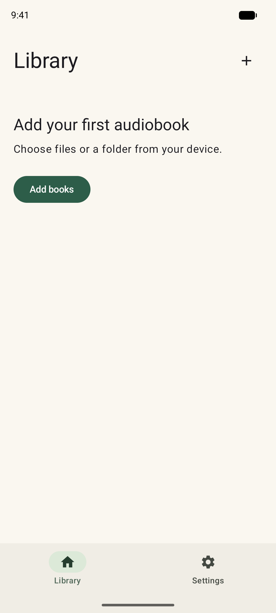
  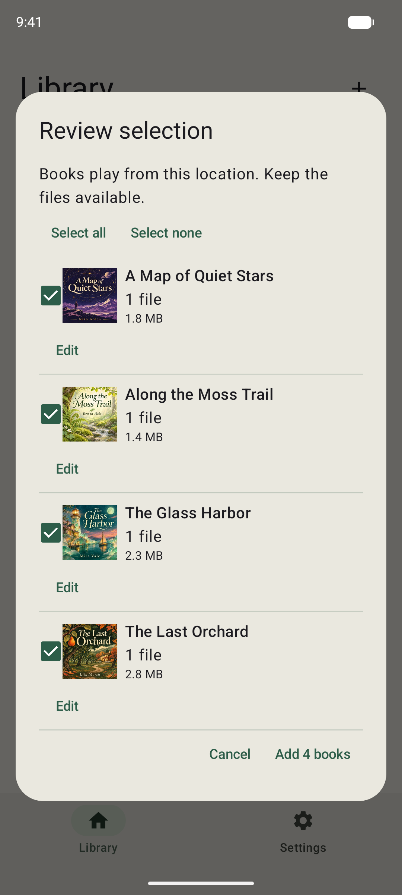

Audio stays at the selected location. Keep those files available and leave a
removable card connected while listening. The app stores book details, covers,
progress, and bookmarks privately; it does not make permanent audio copies for
new imports or modify the originals.

Cancelling preparation adds nothing. Cancelling after additions begin keeps books
already added. If interrupted work is offered on reopening, **Later** lets you
continue using the library. **Add books → Unfinished imports** reopens explicit
cleanup; it keeps added books and original files.

## Find a book

Use **Search**, **Sort**, and the list/grid button in Library. **All**,
**In progress**, **Unplayed**, and **Finished** narrow the view by listening state.
An unstarted book shows its duration, an active book its estimated listening time
left, and a completed book **Finished**. Time left accounts for playback speed.

Open **Filters** to select genres and authors derived from your books' metadata.
You can select several choices. A book can match any selected genre and any
selected author; those groups combine with search and listening state. The count
updates immediately. Switch between **Genres** and **Authors**, or search options
inside the sheet. Closing keeps your selections; **Clear all** resets both groups.

  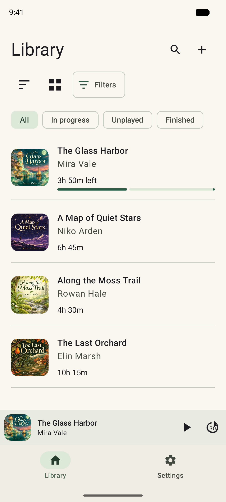
  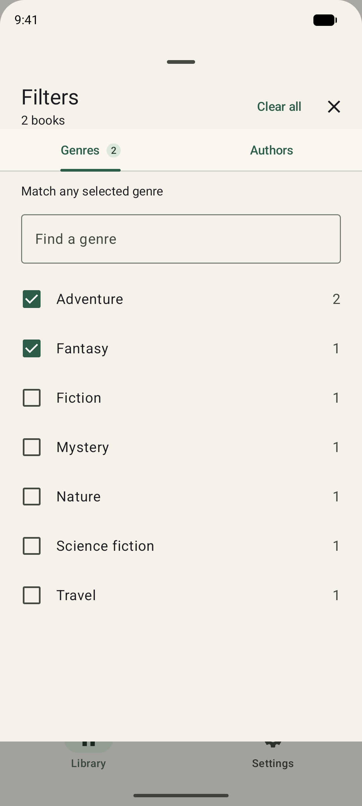
  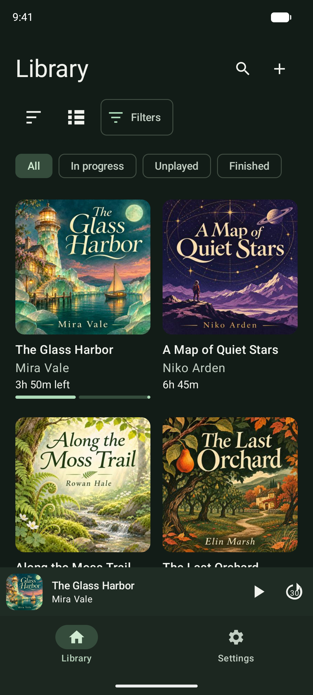

## Listen and navigate

Open a book, then choose **Play**, **Resume**, or **Open player**. Opening the
player for a loaded book preserves its play/pause state. The mini player opens
the same player and offers separate play/pause and skip controls.

The large center button plays or pauses. Timed skips default to 10 seconds back
and 30 seconds forward; previous/next chapter are separate controls. Drag the
position bar to seek. **Undo seek**, when shown, returns to the previous point.

**Chapter / Book** changes the bar's range and time readouts. It does not change
playback mode or stop at chapter boundaries. Book scope is unavailable when total
duration is unknown. Player times describe audio position; the library's time-left
estimate also accounts for speed.

**Chapters** opens navigation with the current chapter highlighted. Tap a row to
jump to its beginning, including restarting the current chapter. A loaded book
keeps its play/pause state. Browsing or closing the sheet does not seek. For files
without embedded chapters, file boundaries provide navigation.

  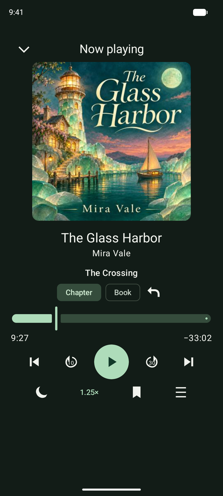
  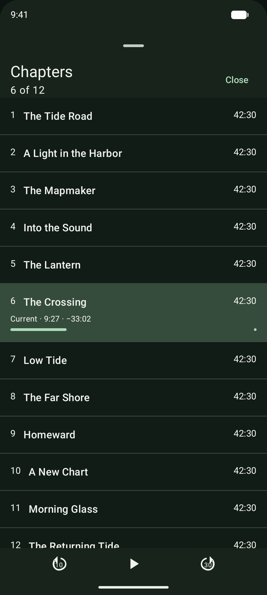

Playback can continue with the screen off or while using another app. Android's
media notification and lock-screen controls operate the same session. Reopening
after the process stops restores the saved position paused; press Play to continue.

## Speed and sleep timer

Tap the speed value to adjust from **0.50× to 3.00×**. Use the slider, precise
0.05× minus/plus controls, or quick values. Applied changes remain when you close
the sheet. Each book remembers its speed. **Settings → Default speed** changes
the fallback for books without a remembered speed.

Tap the moon for **Sleep timer**. Choose a preset, **End of chapter**, or enter
1–1,440 whole minutes and tap **Start**. Minute timers use elapsed time rather
than audio speed. **Stop timer** appears while a timer is active; cancelling or
closing the picker leaves the current timer unchanged. Timers do not survive
playback-service recreation.

  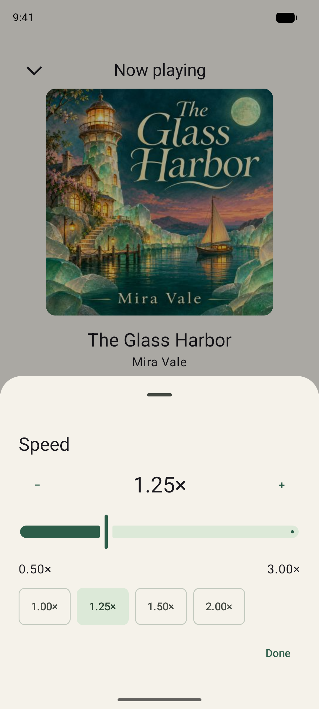
  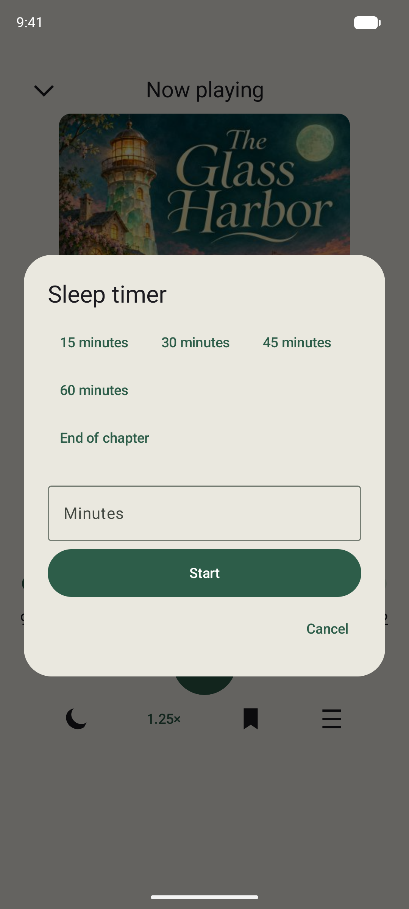

## Bookmarks and notes

Tap the player's bookmark icon to capture the current point. Add an optional note
and tap **Save**. Book details → **Bookmarks** lists saved points; tap a row to
jump there. Its overflow menu offers **Edit note** and **Remove**. Editing a note
keeps the original bookmark position. Clearing its text leaves the bookmark.

Closing a note editor keeps its draft for reopening during the current app
session; **Cancel** discards it and **Save** commits it. Do not rely on unsaved
drafts after the app process ends.

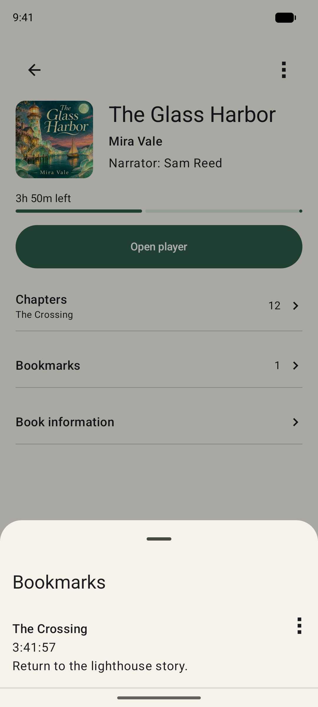

## Book details and corrections

The book overview keeps cover, credits, listening state, chapters, and bookmarks
together. **Book information** shows available description, genre, publisher,
explicit release date, and full duration. Missing or ambiguous catalog values
are omitted.

The book's three-dot menu contains **Edit book**, **Choose cover**, **Mark
finished**, **Reset progress**, and **Remove book**, plus relevant recovery
actions. Edits stay in this library and do not rewrite audio tags. **Reset edits**
returns edited fields to imported values. Choosing a cover uses the system picker.
Resetting progress and removing a book have separate confirmation and consequences;
read the dialog before committing.

  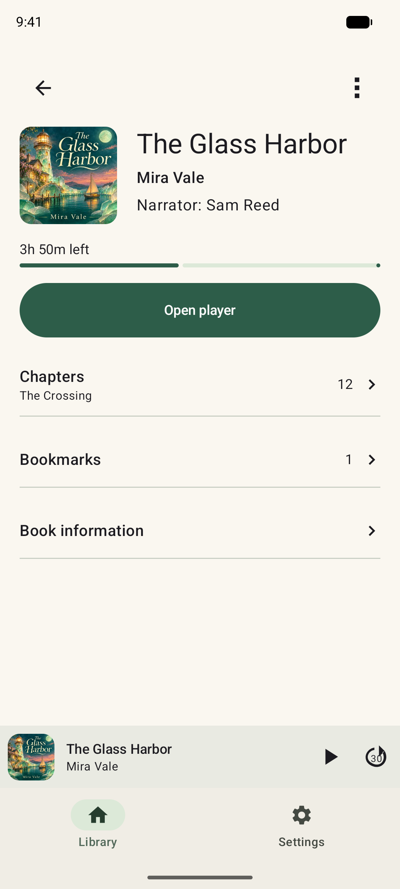
  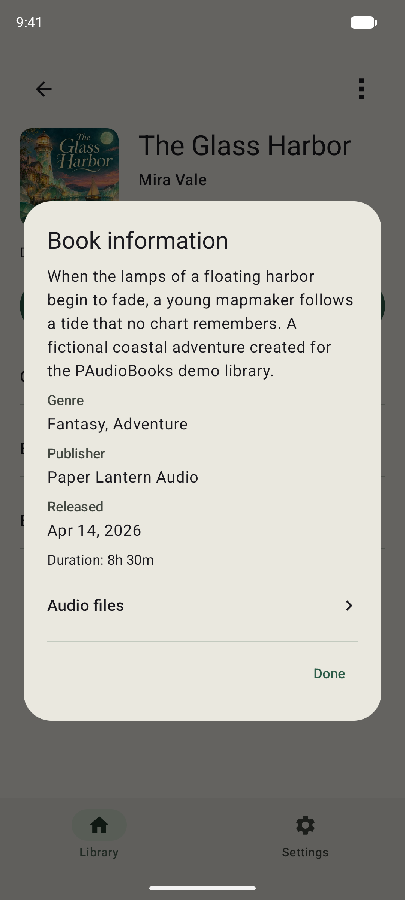
  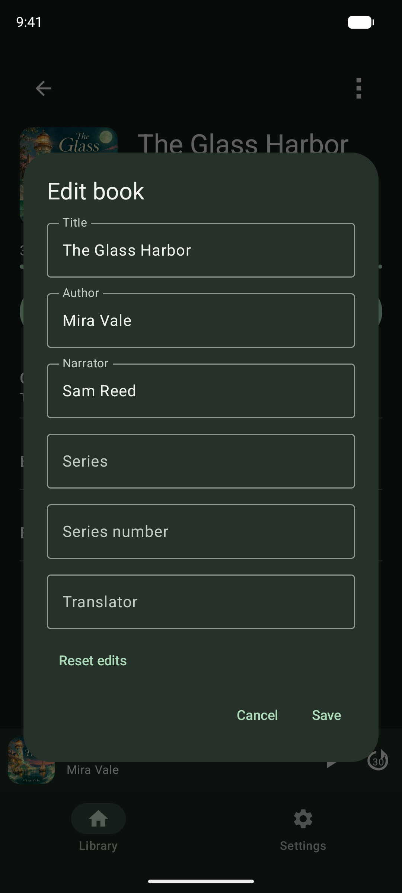

## Audio files and recovery

Open **Book information → Audio files** for source availability, formats, counts,
sizes, and maintenance. **Verify audio identity** explicitly reads source bytes
for fingerprint matching. **Rescan folder** reviews new files under that book's
folder; it does not silently remove missing tracks or reorder retained files.
**Read metadata** appears when details remain pending. These operations can pause
the affected loaded book and show their own confirmation/progress.

If audio becomes unavailable, keep the library entry and use its recovery action.
Restore access to the original location or use **Reconnect audio** when offered.
Matching a different location requires identity verification; names alone do not
prove it is the same audio. Missing audio does not require resetting progress.

Removing a book deletes its local library/listening records and releases its
access when no longer needed. It never deletes original audio. Export progress
first if you want to retain notes and listening history.

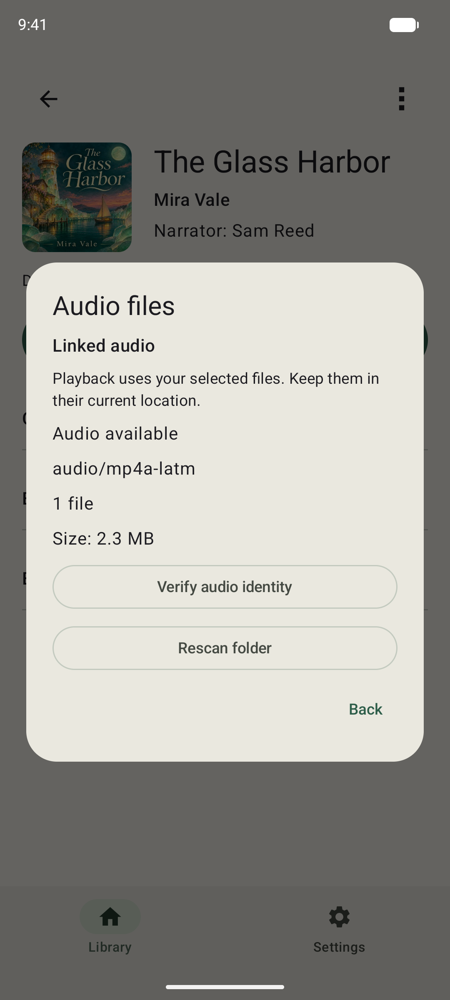

## Appearance, privacy, and progress transfer

**Settings → Appearance** offers **System**, **Light**, and **Dark**. System is
the default. Switching themes preserves playback and navigation. Settings also
contains skip intervals, smart rewind, and lock-screen detail visibility. Turning
off **Show book details on lock screen** uses generic session details while
keeping transport controls.

**Export progress** saves a file you choose containing book titles, audio
fingerprints, progress, bookmarks/notes, and edited details. Audio and document
permissions are excluded. Export pauses playback to save current progress. The
file is unencrypted; store it privately.

On another installation, first add the corresponding audio, then choose **Import
progress**. Preview matching books and conflicts, select what to replace, and
confirm explicitly. Matching uses verified audio fingerprints rather than title
alone; source permissions must be granted separately. This is manual transfer,
not automatic backup or sync. Export before uninstalling or clearing app data.

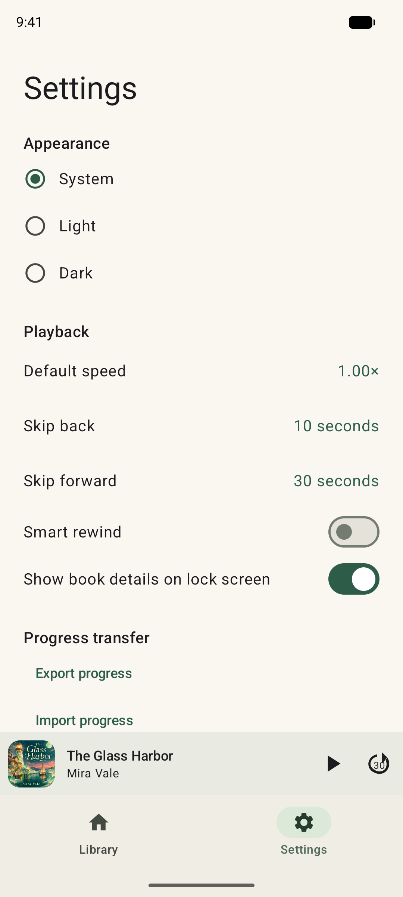

## If something goes wrong

| Symptom | What to try |
| --- | --- |
| File not shown in picker | Use Show other files, then select local audio; support depends on its actual encoding. |
| Cover, duration, or chapters missing | Open Audio files and use Read metadata if offered. Missing tags are not necessarily a playback failure. |
| Book unavailable | Reconnect the card/location, restore the original files, or use the offered access-recovery action. Keep the library entry and progress. |
| Book seems missing from Library | Check search, status, and genre/author filters; clear active filters. |
| Progress cannot be saved | Free device space and retry. The app pauses rather than claiming unsaved progress is durable. |
| Unsupported or corrupt audio | Try a supported local encoding or an intact original. The app does not download codecs or convert files. |

MP3, DRM-free AAC M4B/M4A, FLAC, Ogg Vorbis/Opus, and WAV PCM are the intended
format families. Actual extraction, seeking, and decoding depend on the file,
provider, and device. There is no DRM removal, streaming, or remote repair path.
